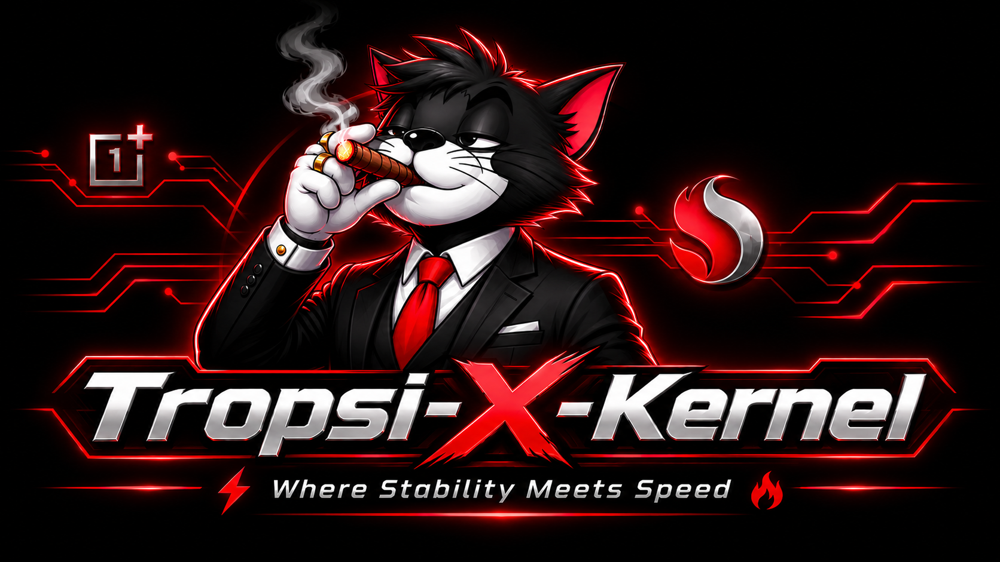

<div align="center">



### Built on the **latest OEM source** for **OxygenOS 13.1 & OxygenOS 14**

</div>

---

## 📱 Supported Devices

| Device | Status |
|---|---|
| OnePlus 8 | ✅ Supported |
| OnePlus 8 Pro | ✅ Supported |
| OnePlus 8T | ✅ Supported |
| OnePlus 9R | ✅ Supported |

## 🧩 Supported ROMs

- ✅ Stock OxygenOS 13.1 (A13) & OxygenOS 14 (A14)
- ⏳ Custom ROMs & port ROMs: planned for the future

> 🎯 Plan: first make the kernel fully stable on stock, then add custom ROM and port ROM support.

## 🔐 Root

- 🛡️ **BakaSU**
- 👻 **SUSFS**
- 📂 **NoMount**
- 📡 **Baseband Guard**
- 🧰 Managers: KernelSU Official, KOWSU, BakaSU

## 📥 Install

1. ⬇️ Download the AnyKernel3 zip
2. 💾 Back up your boot and dtbo
3. 🔧 Boot to recovery and flash the zip
4. 🔄 Reboot

## 💬 Tropsi-X-Kernel on Telegram

📢 **Updates channel:** every new release is posted here first
💬 **Discussion group:** kernel discussion, help and support

[](https://t.me/TropsiXKernelUpdates)
[](https://t.me/TropsiXKernel)

🆘 Kernel not working on your device? Post in the group with your **device**, **ROM** and **firmware version**.

## ❤️ Support the Project

Enjoying Tropsi-X-Kernel? You can support its development. This is optional.

**USDT (TRC20)**
```
TTL3HHUeyfDTXZ5RFqDr4Q379f8DXUJtjb
```
⚠️ Send only USDT on the **TRON (TRC20)** network.

## 🙏 Credits

- **JackA1ltman** ([NonGKI_Kernel_Build_2nd](https://github.com/JackA1ltman/NonGKI_Kernel_Build_2nd)): kernel build system
- OnePlus: OEM kernel source
- libxzr, toraidl, DawfukFR, ppajda: reference kernels
- simonpunk: SUSFS
